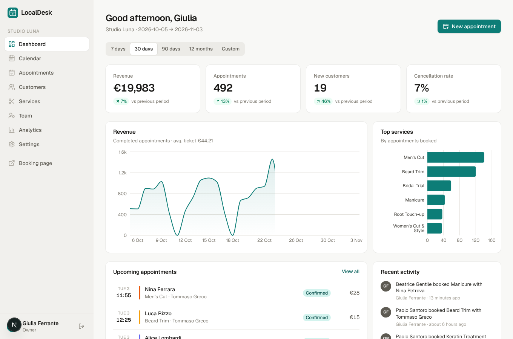
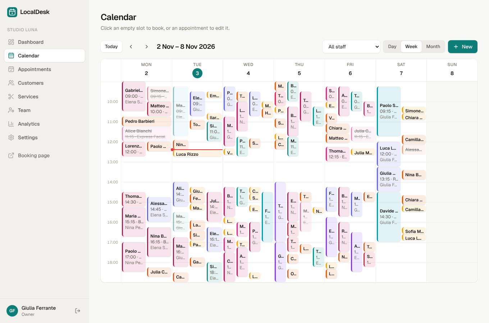
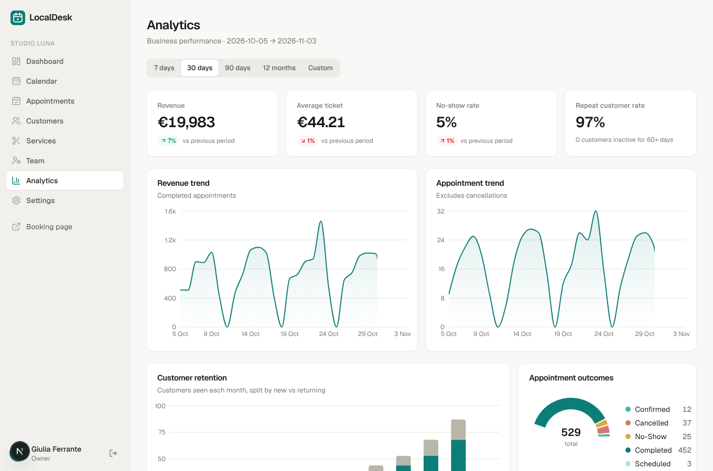
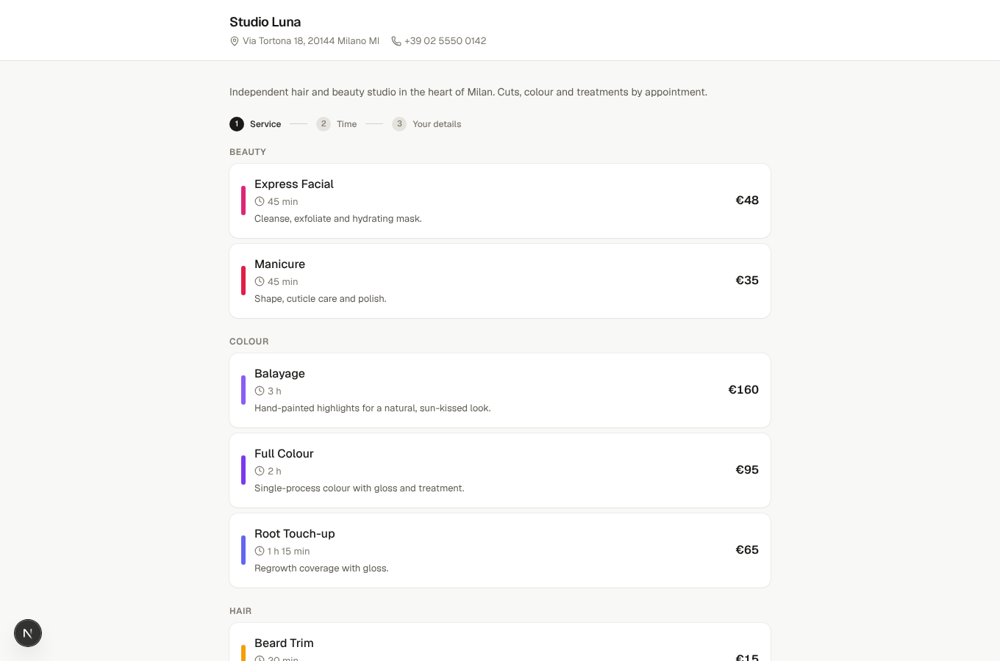

# LocalDesk

**Appointment booking, customer management and analytics for local businesses.**
A full-stack SaaS built with Next.js 15, TypeScript, PostgreSQL and Drizzle ORM — a portfolio project demonstrating multi-tenant architecture, secure auth, a custom calendar, a public booking flow and an analytics suite.

| Dashboard | Calendar |
|---|---|
|  |  |
| **Analytics** | **Public booking page** |
|  |  |

More: [landing page](docs/screenshots/landing.png) · [services](docs/screenshots/services.png) · [team](docs/screenshots/staff.png) · [customers](docs/screenshots/customers.png) · [settings](docs/screenshots/settings.png)

## Features

**Marketing site** — landing page, features, how-it-works, pricing, FAQ, responsive nav and footer. Testimonials are clearly labelled demo content; pricing is illustrative (no billing provider is connected).

**Auth & onboarding** — registration/login with bcrypt (cost 12) and signed, httpOnly JWT session cookies; login/registration rate limiting; 3-step onboarding wizard (business, opening hours, first service/staff); roles `owner`, `admin`, `staff` with a central permission matrix.

**Dashboard** — revenue, appointments, new customers and cancellation-rate KPIs with period-over-period change, revenue chart, top services, upcoming appointments, recent activity, presets (7d/30d/90d/12m) and custom date range.

**Appointments & calendar** — day (one column per staff member), week and month views; click-to-book; create/edit/cancel/complete/no-show; side-by-side layout for concurrent events; "now" indicator; staff filter; searchable, filterable, paginated list; quick inline customer creation.

**Conflict prevention** — three layers: availability computation, a server-side check in every write path, and a PostgreSQL **exclusion constraint** (`btree_gist`) so two active appointments for one staff member can never overlap, even under race conditions (covered by an integration test).

**Public booking** (`/book/<slug>`) — service → professional/"any" + date + time → details. Slots respect business hours, staff shifts, time off, buffers, minimum notice, maximum advance and existing bookings; the slot is re-validated at submit time. Customers are matched by email.

**CRM** — directory with search, tag filter, sorting, pagination; profile with contact details, lifetime value, favourite service, appointment history and private team notes.

**Services & team** — categories, durations, prices, colours, online-bookable flag; per-staff working hours (split shifts), service assignment, time off; deleting something with history archives it instead.

**Analytics** — revenue & appointment trends (day/week/month buckets), new vs returning customers, repeat rate, lapsed customers, popular services, per-professional performance, busiest days/hours, outcome breakdown, top customers.

**Settings** — business profile and booking URL, timezone/currency, opening hours (with breaks), booking rules, notification preferences, account/password, and team logins (owner only).

## Tech stack

| Concern | Choice |
|---|---|
| Framework | Next.js 15 (App Router, Server Components, Server Actions), React 19 |
| Language | TypeScript (strict) |
| Database | PostgreSQL 16 + Drizzle ORM, SQL migrations (`drizzle/`) |
| Auth | bcryptjs + `jose` JWT in httpOnly cookie, role-based permissions |
| Validation | Zod (shared by forms and server actions) |
| UI | Tailwind CSS v4, hand-built design system, lucide icons, Geist font |
| Charts | Recharts |
| Dates | date-fns + date-fns-tz (UTC storage, business-timezone display, DST-tested) |
| Tests | Vitest (unit + DB integration) |

## Getting started

Requirements: Node 20+ (22 recommended) and PostgreSQL 14+ (or Docker).

```bash
git clone <repo> && cd localdesk-saas
npm install
cp .env.example .env            # then set AUTH_SECRET (openssl rand -base64 48)
docker compose up -d db         # or use your own Postgres and edit DATABASE_URL
npm run db:setup                # runs migrations + seeds demo data
npm run dev                     # http://localhost:3000
```

`npm run db:seed` can be re-run any time; it resets the demo business ("Studio Luna").

### Demo accounts (password `LocalDesk2026!`)

| Email | Role | Can access |
|---|---|---|
| `owner@demo.localdesk.app` | Owner | everything, incl. team access |
| `manager@demo.localdesk.app` | Admin | everything except team access |
| `staff@demo.localdesk.app` | Staff | calendar, appointments, customers |

The seeded business has 4 team members, 10 services, 90 customers and ~4,000 appointments spanning the past year and the next three weeks. Public booking page: `/book/studio-luna`.

### Scripts

| Command | Purpose |
|---|---|
| `npm run dev` / `build` / `start` | Next.js |
| `npm run lint` · `npm run typecheck` | ESLint · tsc |
| `npm test` | Vitest (integration tests need the migrated database) |
| `node scripts/e2e.cjs` | Browser end-to-end + mobile audit against a running app |
| `npm run db:generate` | Generate a migration after editing `src/db/schema.ts` |
| `npm run db:migrate` · `db:seed` · `db:setup` | Apply migrations · seed · both |

### Screenshots

With the app running and seeded: `node scripts/screenshots.cjs` (uses Playwright) writes images to `docs/screenshots/`.

## Environment variables

| Name | Description |
|---|---|
| `DATABASE_URL` | PostgreSQL connection string |
| `AUTH_SECRET` | ≥ 32 chars; signs session cookies. The app refuses to start sessions without it |
| `NEXT_PUBLIC_APP_URL` | Public base URL (used for booking links/metadata) |

## Architecture

```
src/
  app/
    (auth)/        login, register, onboarding wizard
    (app)/         authenticated shell: dashboard, calendar, appointments, customers,
                   services, staff, analytics, settings (each page enforces permissions)
    book/[slug]/   public booking page
    actions/       Server Actions — auth, appointments, customers, catalog, settings, public booking
  components/      ui/ design system, calendar, charts, forms, marketing
  db/              schema.ts, migrations runner, seed.ts
  lib/             auth, permissions, availability (pure), time/range utils, validation (zod)
  server/          booking.ts (conflict-safe writes), queries.ts, stats.ts (SQL aggregations)
drizzle/           generated SQL migrations (+ the exclusion-constraint migration)
tests/             unit + integration tests
```

**Multi-tenancy.** Every business-owned table carries `business_id`; every query and mutation is scoped by the business from the authenticated session, and foreign ids coming from the client (customer, service, staff…) are re-verified against it before use.

**Authorization.** `requireCtx(permission)` guards pages; `actionCtx(permission)` guards server actions. The matrix lives in `lib/permissions.ts`. UI hiding is cosmetic — the server enforces.

**Time.** Instants are stored as `timestamptz` (UTC). Opening hours and shifts are wall-clock times interpreted in the business timezone; analytics bucket in that timezone via `AT TIME ZONE`.

**Availability.** `lib/availability.ts` is a pure function (easy to test): intersect business hours with staff shifts → step through candidate slots → drop those hitting busy intervals/buffer/notice/advance limits.

## Security considerations

Audited in the final review (see `tests/tenancy.integration.test.ts` and `scripts/e2e.cjs`):

- **Passwords**: bcrypt (cost 12), 10–72 chars with letters and digits (72 = bcrypt's input limit). Unknown-email logins still run a bcrypt comparison to blunt user enumeration by timing.
- **Sessions**: HS256 JWT in an `httpOnly`, `SameSite=Lax` cookie (`Secure` in production), 7-day expiry. User and membership are re-read from the database on **every request**, so removing a team member or changing a role takes effect immediately. Each user has a `session_version`; **changing the password revokes every other session** (verified end to end).
- **Authorization**: central permission matrix (`lib/permissions.ts`); pages call `requireCtx(permission)` and every Server Action calls `actionCtx(permission)`. Staff users are redirected away from dashboard/analytics/settings/services/team and rejected by the actions behind them.
- **Tenant isolation**: every query/mutation filters by the session's `business_id`; client-supplied foreign ids (customer, service, staff, appointment, note, time-off) are re-checked against that business. Integration tests prove a business cannot book with, read, modify or see revenue of another business's data.
- **SQL injection**: Drizzle parameterised queries / `sql` tagged templates only; the single `sql.raw` call interpolates an internal enum (`day|week|month`).
- **CSRF**: Server Actions enforce same-origin (Next.js) and the cookie is `SameSite=Lax`; there are no state-changing GET endpoints.
- **XSS**: React escaping everywhere, no `dangerouslySetInnerHTML`; colours are regex-validated before being used in styles. Production responses send a CSP (`script-src 'self' 'unsafe-inline'` — Next.js inlines bootstrap scripts; a nonce-based CSP is a possible hardening), HSTS, `X-Frame-Options: DENY`, `nosniff`, a referrer policy and a permissions policy.
- **Input validation**: Zod on every action; price/length caps; opening hours and shifts validated (overlaps, order).
- **Double booking**: PostgreSQL exclusion constraint + app checks; 8 concurrent bookings of one slot yield exactly one success (tested).
- **Rate limiting**: login (per IP+email), registration, public slot lookups and public bookings. Limits are in-memory and keyed on `X-Forwarded-For`, so they only hold behind a proxy that sets/overwrites that header, and per instance.
- **Secrets**: only `.env` (git-ignored); `AUTH_SECRET` must be ≥ 32 chars. The demo seed **refuses to run when `NODE_ENV=production`** (it creates accounts with a published password) unless `ALLOW_DEMO_SEED=true`.
- **Dependencies**: `npm audit --omit=dev` reports a PostCSS advisory bundled inside Next.js (build-time CSS tooling that does not process user input at runtime); resolved by upgrading Next when a patched release is available.

Public-booking caveat: a visitor may book using someone else's email address (no email verification, because no mail provider is configured). The booking is attached to that customer record; only the business can see it.

## Deployment requirements

- Node 20+ and PostgreSQL 14+ (the `btree_gist` extension must be creatable — it's a *trusted* extension on PG13+, so a non-superuser owner works).
- Env: `DATABASE_URL`, `AUTH_SECRET`, `NEXT_PUBLIC_APP_URL`.
- `npm ci && npm run db:migrate && npm run build && npm start` (do **not** run `db:seed` in production).
- Serve over HTTPS behind a proxy that overwrites `X-Forwarded-For`; run a single instance or replace the in-memory rate limiter first.
- Back up the database; there is no file storage.

## Verification status

Verified in the audit (Chromium, desktop 1280px + mobile 390px, production build, seeded database):
registration → onboarding → dashboard; login/logout and failed login; calendar create / conflict rejection / cancel; day, week and month views; appointment list filters; customer create, search, notes, 404 for unknown ids; service create/delete; staff time off; booking-rule settings; dashboard range filter; password change revoking other sessions; public booking; staff-role redirects; no horizontal overflow and no console errors on 13 mobile pages. Automated: 28 Vitest tests (availability incl. DST, permissions, validation, ranges, DB constraint, tenant isolation, concurrency); lint, typecheck and production build clean; migrations apply to an empty database and the seed is idempotent.

Re-run the browser checks with `node scripts/e2e.cjs` against a running seeded app (it creates a few throwaway records; re-seed afterwards).

## Known limitations

- **No emails/SMS.** Notification preferences are stored but nothing is sent; there is no email verification or password-reset flow.
- **Billing is not integrated**; pricing is illustrative.
- Sessions are stateless JWTs (revocable only via password change / membership removal); no 2FA, no account lockout beyond rate limits.
- Rate limiter is in-memory (see above).
- Customers cannot self-cancel or reschedule; staff do it from the dashboard. Dashboard bookings may be placed outside a staff member's working hours (conflicts and time off are still enforced); online bookings cannot.
- Adding time off does not move existing appointments.
- One business per user in the UI (the schema supports more); team logins are created by the owner with a temporary password rather than invitation emails.
- Week view with many staff is dense on phones — the day view (one column per professional) is the better mobile view.
- Revenue counts *completed* appointments only.
- Demo data's repeat-customer rate is unrealistically high (seed artefact).
- Not penetration-tested or load-tested.

## License

MIT
